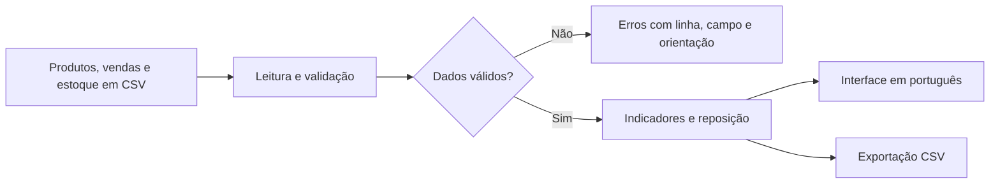

# Arquitetura planejada

Status: proposta de implementação; os módulos abaixo ainda não existem.

## Fluxo

## Responsabilidades

| Componente futuro | Responsabilidade |
| --- | --- |
| src/monitor_estoque/importacao.py | Ler conteúdo CSV em UTF-8, preservar textos e conferir cabeçalhos |
| src/monitor_estoque/validacao.py | Validar tipos, limites, unicidade, referências e datas |
| src/monitor_estoque/indicadores.py | Agregar valores e calcular margem e cobertura |
| src/monitor_estoque/reposicao.py | Calcular estoque-alvo, compra sugerida e prioridades |
| src/monitor_estoque/exportacao.py | Produzir CSV consistente com a análise exibida |
| app.py | Apresentar importação, filtros, resultados e mensagens |
| tests/ | Verificar importações, regras, limites e referências sintéticas |

Os componentes de negócio devem ser importáveis e verificáveis sem iniciar a interface. Compartilhe modelos simples de dados e erros estruturados quando necessário; evite criar camadas sem uma necessidade concreta.

## Decisões iniciais

- Python como linguagem; escolher e documentar versão suportada durante a implementação.
- Processamento local, sem banco de dados, contas de usuário ou serviços externos no MVP.
- Não instalar dependências nesta fase de planejamento. Escolher bibliotecas de interface e gráficos ao iniciar a apresentação, usando documentação oficial atualizada.
- Valores monetários em Decimal; calcular a margem agregada pela razão dos totais, não pela média das margens percentuais.
- Para quantidades e reposição, preservar precisão suficiente para não errar o arredondamento para cima nas fronteiras; usar aritmética exata ou uma abordagem demonstravelmente segura.
- Validar os três arquivos antes de liberar a análise. Não descartar silenciosamente registros inválidos.
- Erros devem conter arquivo, linha física quando aplicável, campo, motivo e orientação. Erros entre arquivos podem apontar o SKU e os arquivos envolvidos.
- Parâmetros: início e fim inclusivos, fim igual à data do estoque e dias de segurança inteiros não negativos.
- A seleção de categoria/produto filtra os resultados e a exportação; a seleção de período recalcula os indicadores. A interface deve comunicar isso.
- Exportar os parâmetros e a referência temporal junto aos resultados, em colunas ou arquivo complementar documentado.
- Não armazenar uploads entre sessões na primeira versão. Não registrar conteúdo sensível em logs.

## Limites conhecidos

Não há previsão estatística de demanda. A média diária é uma estimativa descritiva que inclui dias sem vendas. A margem depende do preenchimento correto dos custos variáveis; impostos só estarão refletidos se corretamente contemplados nos dados de custos definidos. Não há apuração tributária.

Dados de devolução, cancelamento e estoque em trânsito exigirão nova especificação antes de serem aceitos. Um futuro projeto de faturamento deverá ter escopo e contrato próprios.
